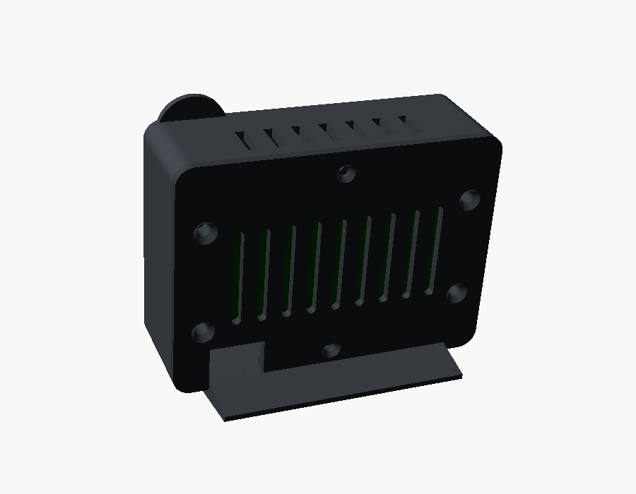
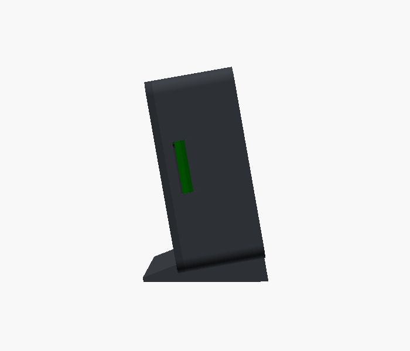

# Gehäuse: Mini-Haltestelle

Parametrisches OpenSCAD-Modell eines schlichten Kastens für den Schreibtisch. Er steht um
10° nach hinten geneigt auf einem schmalen Keil-Sockel. Einzige Anspielung auf die
Haltestelle ist ein kleines rundes Schild oben rechts mit vertieftem „H", in derselben
Farbe wie der Rest. Keine Logos von Verkehrsunternehmen.

  

```bash
make stl     # alle Teile nach stl/
make png     # Vorschaubilder nach vorschau/
openscad -D 'part="front"' -o front.stl mini-haltestelle.scad   # ein einzelnes Teil
```

> **Entwurf, ungeprüfte Maße.** Für das Display HAT Mini gibt es keine öffentliche
> Maßzeichnung, die sich abrufen ließ. Alle Werte mit „(prüfen)" oben in
> `mini-haltestelle.scad` vor dem ersten Druck mit dem Messschieber nachmessen. Vorher
> lohnt ein Probedruck nur der Frontplatte (Druck nach 2–3 mm abbrechen).

## Teile

| Teil | `part=` | Lage im Drucker | Hinweise |
|---|---|---|---|
| Vorderteil mit Sockel und Schild | `front` | Vorderseite aufs Bett | keine Stützen nötig: Fenster mit Fase, das „H" ist eine Vertiefung in der ersten Schicht |
| Deckel | `back` | Außenseite aufs Bett | Lüftungsschlitze, Kabelkerbe, 4 Stützen zum Pi |
| Lichtleiter | `lichtleiter` | stehend | optional, klares/naturfarbenes PETG, leitet die RGB-LED nach vorn |

Einfarbig drucken, z. B. anthrazit oder weiß. Empfehlung PLA, 0,2 mm Schichthöhe,
3 Wände. Damit das „H" sauber wird, die erste Schicht nicht zu stark andrücken
(Elephant's Foot schließt die 0,6-mm-Vertiefung sonst teilweise). Die Taster-Zungen federn
nur, wenn die Frontplatte dünn bleibt (`front_t` = 1,6 mm).

## Material

| Was | Anzahl |
|---|---|
| Pi Zero W + Display HAT Mini mit den beiliegenden 10-mm-Abstandshaltern | 1 |
| M2 × 6 Blechschraube (Deckel) | 2 |
| M2,5 × 8 Schraube (Deckel → Abstandshalter, ersetzt die kurzen Schrauben unter dem Zero) | 4 |
| Micro-USB-Kabel mit **gewinkeltem** Stecker. Der Stecker muss nach hinten zeigen, wenn er von unten in der Buchse steckt. | 1 |

## Montage

1. Display HAT und Zero wie vorgesehen mit den Abstandshaltern verschrauben, aber die vier
   Schrauben **unter** dem Zero weglassen.
2. Gewinkeltes USB-Kabel einstecken, der Stecker zeigt nach hinten.
3. Stapel mit dem Display nach vorn ins Vorderteil legen. Das Glas liegt innen an der
   Frontplatte, die Noppen der Zungen sitzen über den Tastern.
4. Deckel aufsetzen, Kabel durch die Kerbe unten führen. Die vier M2,5-Schrauben durch die
   Stützen in die Abstandshalter drehen, dann die zwei M2-Schrauben in die Dome.

## Anpassen

| Variable | Wirkung |
|---|---|
| `tilt` | Neigung nach hinten. Mehr Neigung braucht mehr `base_h`, sonst läuft der Keil zu früh aus. |
| `base_h`, `base_ext`, `base_inset` | Sockelhöhe vorn, Überstand hinten (gegen Kippen beim Drücken), seitlicher Einzug |
| `sign_d`, `sign_rise`, `sign_inset`, `h_depth` | Größe und Lage des Schilds, Tiefe des „H" |

## Vor dem ersten Druck nachmessen

| Variable | Was | Annahme |
|---|---|---|
| `hat_w`, `hat_h`, `hat_dy` | Außenmaß des HAT, Versatz zum Zero | 65,5 × 35, mittig |
| `win_w`, `win_h`, `win_dx`, `win_dy` | sichtbare Displayfläche und ihre Lage | 40,8 × 30,6, mittig |
| `disp_front_h` | Glasoberkante über HAT-Platine | 4,2 |
| `btn_dx`, `btn_dy`, `btn_h` | Tastermitten, Höhe der Tasterkappe | ±28, ±7, 1,6 |
| `led_x`, `led_y` | Lage der RGB-LED | links Mitte |
| `stack_h` | Unterseite Zero bis Glasoberkante | 17 |
| `usb_pwr_x`, `sd_y` | Lage von Micro-USB und microSD am Zero (offiziell) | 54 / 16,9 |

Koordinaten: `x` negativ ist **von vorn gesehen links**, Ursprung in der Mitte der Platinen.
Am einfachsten das Display HAT flach hinlegen, alle Maße von der linken unteren Ecke
nehmen und dann in Mittenwerte umrechnen (Mitte = halbe Breite bzw. Höhe).

Die erste Fassung mit Mast, Standfuß und großem farbigem Schild liegt in der Git-Historie
(Commit „Gehäuse-Entwurf (Phase 3)").
