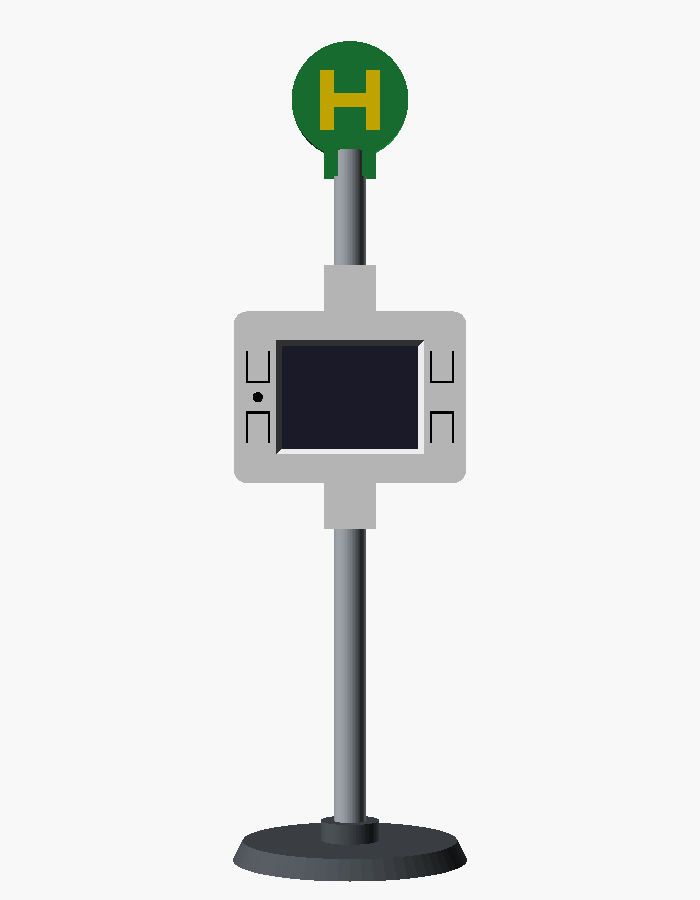
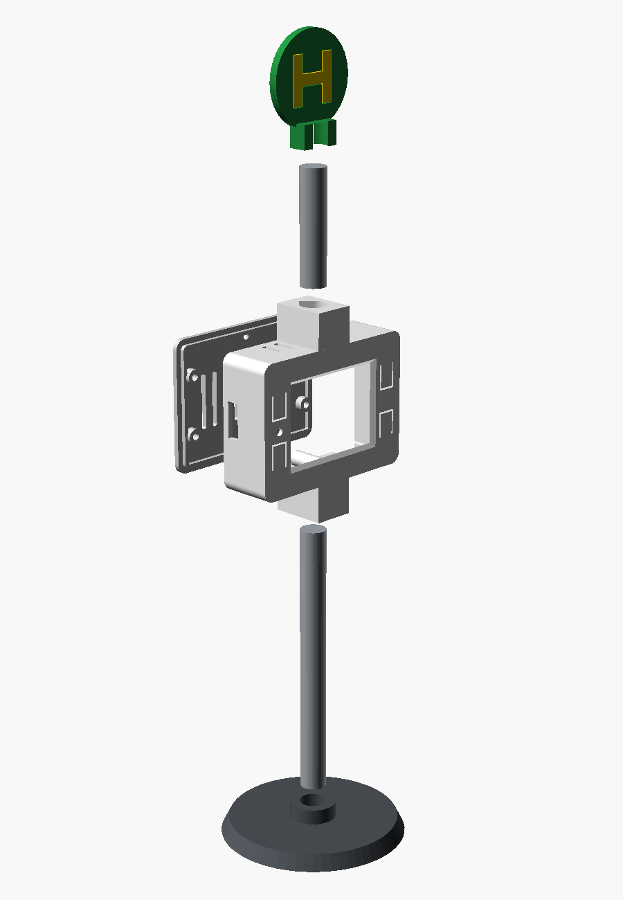

# Gehäuse: Mini-Haltestelle

Parametrisches OpenSCAD-Modell. Von unten nach oben: Standfuß, Mast, Gehäuse mit Display,
kurzer Mast, Haltestellenschild (grüner Kreis, gelbes „H"). Keine Logos von
Verkehrsunternehmen.

 

```bash
make stl     # alle Teile nach stl/
make png     # Vorschaubilder nach vorschau/
openscad -D 'part="front"' -o front.stl mini-haltestelle.scad   # ein einzelnes Teil
```

> **Entwurf, ungeprüfte Maße.** Für das Display HAT Mini gibt es keine öffentliche
> Maßzeichnung, die sich abrufen ließ. Alle Werte mit „(prüfen)" oben in
> `mini-haltestelle.scad` vor dem ersten Druck mit dem Messschieber nachmessen. Vorher
> lohnt ein Probedruck nur der Frontplatte (Druck nach 2–3 mm abbrechen).

## Teile

| Teil | `part=` | Farbe | Lage im Drucker | Hinweise |
|---|---|---|---|---|
| Vorderteil | `front` | hellgrau/weiß | Vorderseite aufs Bett | keine Stützen nötig: Fenster mit Fase, Mastbohrungen als Tropfenform |
| Deckel | `back` | hellgrau | Außenseite aufs Bett | Lüftungsschlitze, 4 Stützen zum Pi |
| Mast | `mast` | grau | stehend | 100 % Füllung oder 4 Wände, sonst wackelig |
| Mast oben | `mast_oben` | grau | stehend | |
| Standfuß | `fuss` | dunkelgrau | flach | Mulde unten für Gewicht oder Filzgleiter |
| Schild | `schild` | **grün** | flach | „H" ist vertieft |
| H | `schild_h` | **gelb** | flach | in die Vertiefung kleben oder pressen (0,15 mm Spiel) |
| Lichtleiter | `lichtleiter` | klar/natur (PETG) | stehend | optional, leitet die RGB-LED nach vorn |

Alternativ druckt man Schild und H in einem Teil mit Farbwechsel per Pause (M600) bei der
Schichthöhe `sign_t − h_inlay`.

Empfehlung PLA, 0,2 mm Schichthöhe, 3 Wände. Die Taster-Zungen im Vorderteil federn nur,
wenn die Frontplatte nicht zu dick ist (`front_t` = 1,6 mm).

## Material

| Was | Anzahl |
|---|---|
| Pi Zero W + Display HAT Mini mit den beiliegenden 10-mm-Abstandshaltern | 1 |
| M2 × 6 Blechschraube (Deckel) | 2 |
| M2,5 × 8 Schraube (Deckel → Abstandshalter, ersetzt die kurzen Schrauben unter dem Zero) | 4 |
| Micro-USB-Kabel mit **gewinkeltem** Stecker (passt besser durch die Aussparung) | 1 |

## Montage

1. Display HAT und Zero wie vorgesehen mit den Abstandshaltern verschrauben, aber die vier
   Schrauben **unter** dem Zero weglassen.
2. Stapel mit dem Display nach vorn ins Vorderteil legen. Das Glas liegt innen an der
   Frontplatte, die Noppen der Zungen sitzen über den Tastern.
3. Deckel aufsetzen, die vier M2,5-Schrauben durch die Stützen in die Abstandshalter
   drehen. Danach die zwei M2-Schrauben in die Dome.
4. Masten einstecken, Fuß und Schild aufstecken. Wenn es zu stramm sitzt, `peg_clr`
   erhöhen. Wenn es wackelt, verringern oder einen Tropfen Kleber nehmen.
5. Kabel an der Aussparung unten rechts einstecken und hinter dem Mast herunterführen.

## Vor dem ersten Druck nachmessen

| Variable | Was | Annahme |
|---|---|---|
| `hat_w`, `hat_h`, `hat_dy` | Außenmaß des HAT, Versatz zum Zero | 65,5 × 35, mittig |
| `win_w`, `win_h`, `win_dx`, `win_dy` | sichtbare Displayfläche und ihre Lage | 40,8 × 30,6, mittig |
| `disp_front_h` | Glasoberkante über HAT-Platine | 4,2 |
| `btn_dx`, `btn_dy`, `btn_h` | Tastermitten, Höhe der Tasterkappe | ±28, ±7, 1,6 |
| `led_x`, `led_y` | Lage der RGB-LED | links Mitte |
| `stack_h` | Unterseite Zero bis Glasoberkante | 17 |
| `usb_pwr_x`, `sd_y` | Lage von Micro-USB und microSD am Zero (offiziell) | 54 / 16,9 |

Messen geht am einfachsten so: Display HAT flach hinlegen, alle Maße von der **linken
unteren Ecke** nehmen und dann in Mittenwerte umrechnen (Mitte = halbe Breite/Höhe).
